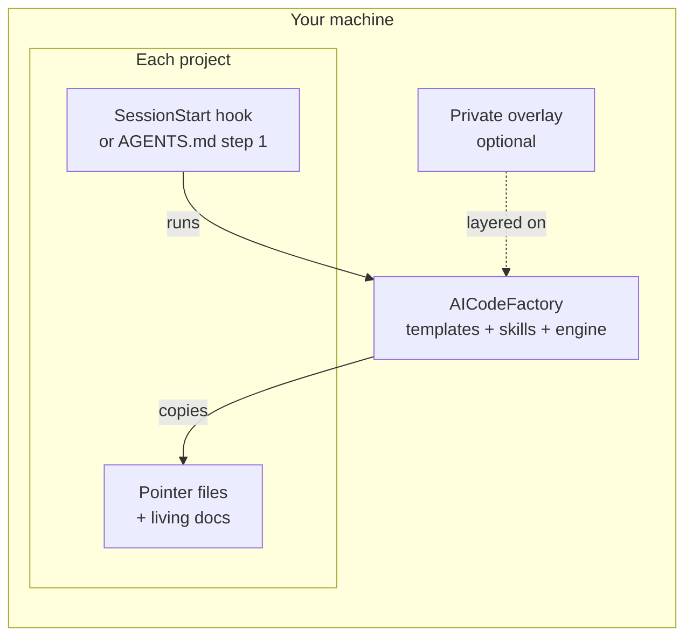

# How the sync works: pull, not symlinks

Each project pulls its AI files from the factory at the start of every session, as plain
copies. Nothing is pushed into projects from outside and nothing is linked, so a project works
the same on every OS, in every clone, even where the factory is absent.

## The flow

1. You open a project. Claude Code runs the hook in `.claude/settings.json`; other agents run
   the same command because `AGENTS.md` tells them to.
2. The hook finds the factory (the sibling folder, `$AI_TEMPLATE_DIR` or the marker
   `aicf setup` wrote) and runs `sync-ai-templates.sh` on the project.
3. The engine fast-forwards the factory and your overlay, renders each template with the overlay
   applied, and copies the result where it differs.
4. It commits the files it changed, only those, in the project's repo.

The [hook reference](../reference/hook.md) lists every step, file and network call.

## Why pull at session start

Your projects should get a rule change on their own, without a bulk command you have to
remember. The moment an agent starts is the one time every tool passes through, so that is when
each project checks itself. A project you never open costs nothing; one you open gets the latest
rules before the agent reads them.

`aicf update --yes` still exists for a bulk refresh, for example right after a template change
when you want every project's commit now.

## Why copies, not symbolic links

Earlier versions linked each project's files to the factory. That broke in three places:

- **Windows.** Creating a symbolic link needs Developer Mode or admin rights, and a checkout with
  `core.symlinks=false` turns each link into a text file holding a path.
- **Clones elsewhere.** A CI runner, a cloud agent or a teammate's clone has no factory at the
  link's target. A copy is a real file that works there.
- **Git history.** A link records a machine path. A copy records the content an agent read when
  it made a commit.

The sync still migrates old links: it replaces each one with a copy.

## Why the hook commits

A refreshed file that stays uncommitted shows up in every `git status`, and an agent that
commits "all changes" would sweep it into unrelated work. So the engine commits the paths it
wrote, and only those (`git commit -- <paths>`): your work in progress is never part of the sync
commit, and the sync commit never carries your work. It never pushes your code repo; that stays
your decision.

## Why the network is bounded

A session must start even offline, on a slow link, or with a remote that hangs. Each network
step waits at most `AI_SYNC_PULL_WAIT` seconds, the whole run at most `AI_SYNC_NET_BUDGET`, and
a pull that is still running is left to finish in the background: the next session sees its
result. A failure is one `ai-sync:` line, never a broken session.

## The first session: bootstrap

The sync copies files; it does not know your project. A new `AGENTS.md` starts with the marker
`<!-- BOOTSTRAP_PENDING -->` and placeholders such as `[PROJECT_NAME]`. When an agent finds the
marker, or no `AGENTS.md` at all (the global instruction `aicf setup` installs tells it to
look), it runs the `bootstrap-ai` skill: init git if needed, run the sync, migrate an older
`.github/copilot-instructions.md`, scan the code (manifests, entry points, frameworks), fill the
placeholders, write `PROJECT_STATE.md`, seed `KNOWLEDGE.md`, remove the marker and commit
`docs: bootstrap project documentation`. Once filled, `AGENTS.md` is the project's and only the
session-start sync keeps running. Type `/bootstrap-ai` to run it by hand.

## Related

- [Pointer files vs living docs](pointers-vs-living-docs.md)
- [How the generic AGENTS.md sections are refreshed](agents-sections-refresh.md)
- [Design decisions](design-decisions.md)
